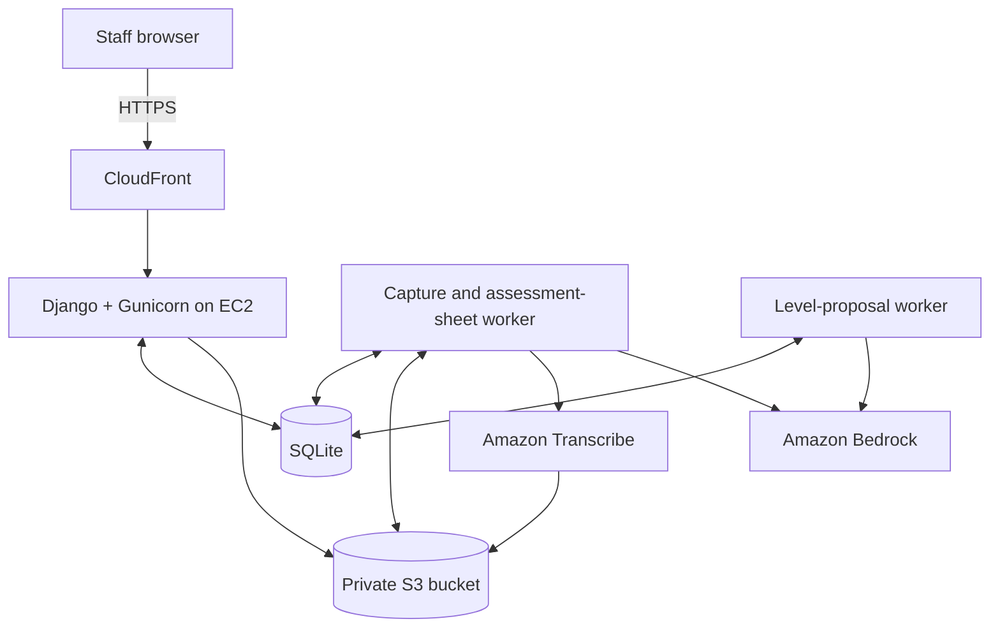

# Kimün — Technical guide

Detailed setup, configuration, architecture, and evaluation reference. For a quick overview, see the [project README](../README.md). Commands assume the repository root unless stated otherwise.

## Deployment availability

The demo presented during the hackathon used AWS resources supplied for the event. There is currently no public hosted demo. The infrastructure definitions in this repository do not provide access to that environment or include AWS credentials.

Local exploration uses a Django development server and the included fictional datasets. Running that server does not reproduce the AI workflow: the latter requires your own AWS configuration and the background workers described below.

## The problem

Early childhood educators collect observations throughout the day, often on paper. Transcribing these records, identifying the child and learning objectives involved, and assembling evidence for an assessment takes time away from their work with children.

Kimün brings capture, review, and learning trajectories into one workflow. AI assists with transcription, organization, and evidence-based suggestions; educators remain responsible for accepting observations and deciding each child's level in each learning area.

The original challenge and pedagogical assumptions are documented in [PLAN.md](../PLAN.md). The [domain research index](../contexto/INDICE.md) links to curriculum sources and findings.

## Implemented features

| Area | Capabilities |
|---|---|
| Observation capture | Written notes, photos of notes, and short audio recordings; browser-side image resizing and microphone recording. |
| AI-assisted organization | Transcription, separation into observations, curriculum tagging, and name matching against the classroom roster. Ambiguous matches remain available for human assignment. |
| Educator review | Edit, assign, accept, or discard observations individually or by capture. |
| Learning trajectories | Child profiles, levels by learning area, assessment history, evidence coverage, and visual summaries. |
| Level proposals | Suggestions based on accepted evidence, with supporting observation references. Educators can accept, adjust, or reject them. |
| Review signals | Comparisons with classroom peers and configurable semester goals, stale evidence, observation frequency, and fortnightly curriculum coverage. |
| Kindergarten management | Director dashboard, classroom comparisons, staff assignment, and child roster management. |
| Safeguarding workflow | Restricted notices for potentially concerning records, exclusion from learning assessment, and configurable kindergarten protocol steps. |
| Standardized assessments | Manual entry or AI-assisted reading of result sheets, consistency checks, educator confirmation, and change history. |
| Family reports | Printable summaries assembled from reviewed evidence and educator-validated levels. |

Review signals use deterministic rules with provisional thresholds. Standardized assessment results are kept separate from the evidence used to propose learning levels. Family reports and suggestions about what to observe next use existing records and curriculum data.

### User roles

| Role | Main permissions |
|---|---|
| Educator (*educadora*) | Capture observations, review evidence, validate levels, maintain the classroom roster, and manage assessment results for assigned classrooms. |
| Assistant (*asistente*) | Capture observations and view assigned classrooms; learning-level decisions remain with the educator. |
| Director (*directora*) | View the kindergarten dashboard, manage classrooms and rosters, capture observations, and access restricted safeguarding notices and assessment results. |

Access is scoped to classroom and kindergarten assignments. Assistants cannot access standardized assessment results or safeguarding notices. The [permission filters](../kimun/registro/permisos.py) define these boundaries.

## How it works

1. A staff member submits a note, photo, or audio recording.
2. A background worker converts the input to text and asks Amazon Bedrock to structure it into observations.
3. The application matches detected names to the classroom roster and saves observations for review. A possible safeguarding concern sends the capture into a restricted workflow instead.
4. The educator reviews, corrects, accepts, or discards the observations.
5. Accepted evidence can trigger a level proposal. The proposal includes the relevant rubric and references the observations supporting it.
6. The educator accepts the suggestion, chooses another level, or rejects it. Generating a proposal alone never changes a validated level.

Proposals record their input fingerprint and prompt version. Changes to evidence or assessment context can make an existing suggestion obsolete. See [proposal processing](../kimun/registro/propuestas.py) and the [proposal prompt](../kimun/registro/ia/prompts/propuesta.md).

## Architecture and technology

The application is a Django monolith with two background management commands. The web process and workers share SQLite; database records also act as the work queue. HTMX polls for results while processing happens outside web requests.



Locally, Django's development server replaces CloudFront and Gunicorn. Uploaded files use local storage unless `KIMUN_BUCKET` is configured; audio transcription still requires S3.

| Layer | Technology |
|---|---|
| Backend | Python 3.12, Django 5.2, Django ORM and authentication |
| Interface | Django templates, HTMX 2.0.11, Pico.css 2.1.1, vanilla JavaScript, SVG charts |
| Database | SQLite; WAL mode in the production configuration |
| AI | Amazon Bedrock Converse API with structured tool outputs |
| Audio | Amazon Transcribe; Amazon Polly for synthetic evaluation audio |
| File storage | Local filesystem or private Amazon S3 through django-storages |
| Hosting | Amazon EC2, EBS, Elastic IP, CloudFront, Gunicorn, WhiteNoise, systemd |
| Infrastructure and access | AWS CloudFormation, IAM, Systems Manager, Parameter Store |
| Testing | pytest, pytest-django, simulated AWS clients |

Python dependencies are pinned in [requirements.txt](../kimun/requirements.txt) and [requirements-dev.txt](../kimun/requirements-dev.txt). Frontend libraries are stored in [static/vendor](../kimun/static/vendor), without a CDN dependency.

## Getting started

### Requirements

- Python **3.12**, with `venv` and `pip` available.
- A local checkout of this repository.
- AWS credentials and service permissions when using AI processing.

You can explore the seeded profiles, classroom dashboards, existing evidence, manual level decisions, and family reports without AWS. Leave `KIMUN_BUCKET` unset to use local file storage, and do not start the AI workers for this walkthrough. New captures will stay pending; no transcription, AI organization, or new level proposals will be generated.

### Install and run locally

From the repository root, choose the commands for your operating system. Ensure the Python executable used to create the environment is Python 3.12.

**Windows / PowerShell**

```powershell
cd kimun
python --version
python -m venv .venv
.\.venv\Scripts\python.exe -m pip install -r requirements-dev.txt
.\.venv\Scripts\python.exe manage.py migrate
.\.venv\Scripts\python.exe manage.py cargar_demo
.\.venv\Scripts\python.exe manage.py runserver
```

**Linux / macOS**

```bash
cd kimun
python3.12 -m venv .venv
source .venv/bin/activate
python -m pip install -r requirements-dev.txt
python manage.py migrate
python manage.py cargar_demo
python manage.py runserver
```

After `runserver` starts, open the address it prints (normally `http://127.0.0.1:8000`) in a browser on the same computer. This address is your local development server, not a hosted demo.

The demo loader prints generated passwords when creating accounts. Use `educadora`, `asistente`, or `directora` to explore the main roles. `educadora_b` and `educadora_c` belong to the other transition classrooms. These are synthetic demo accounts, not shared production credentials.

`cargar_demo` updates existing demo records without duplicating them. Set `DEMO_PASSWORD` before loading to choose demo passwords; use `--cambiar-password` to reset existing demo accounts. Reloading the demo can update its records, so use it against a dedicated demo database.

To access Django administration, create an administrator with `python manage.py createsuperuser` using the virtual environment, then open `/admin/`.

### Local walkthrough without AWS

1. Sign in as `educadora` with the password printed when `cargar_demo` creates the account.
2. Open the assigned classroom and a child's profile to inspect seeded evidence, validated levels, and learning history. Level decisions can be made manually by the educator.
3. Open the review page and a printable family report. These use stored records, not a live AI call.
4. Sign out and sign in as `directora` with its generated password to explore the kindergarten dashboard and classroom summaries.
5. Optionally save a new text note. Its state remains pending while workers are stopped; it will not automatically appear as processed evidence on a child's profile.

This walkthrough was checked with Django's HTTP test client against a fresh temporary database, with DNS and socket connections blocked. It verifies the local page flow and queued text capture, not a browser-based visual review or live AWS processing. The full pipeline requires the next section's setup.

### Start the background workers

For AI processing, keep the web server running and open **two additional terminals** inside `kimun/`, using the same virtual environment and AWS configuration.

On Windows:

```powershell
# Terminal 2: text, photos, audio, and assessment sheets
.\.venv\Scripts\python.exe manage.py procesar_capturas
```

```powershell
# Terminal 3: learning-level proposals
.\.venv\Scripts\python.exe manage.py procesar_propuestas
```

On Linux/macOS, activate the environment in each terminal and use `python manage.py` with the same command names.

`runserver` does not start the workers. The demo seeds pending captures and proposal requests, so starting workers with valid credentials can immediately invoke billable AWS services. Without workers, those records remain queued.

Microphone recording requires HTTPS or localhost. Accessing the development server through a phone's plain HTTP LAN address may allow file uploads but will not provide the same microphone access.

## Configuration

See [.env.example](../kimun/.env.example) for the complete reference. **Django reads process environment variables; it does not automatically load a `.env` file.**

| Variable | Purpose |
|---|---|
| `DJANGO_DEBUG` | Development mode by default; set to `0` for the production configuration. |
| `DJANGO_SECRET_KEY` | Application secret, required in production unless retrieved from Parameter Store. |
| `DJANGO_SECRET_KEY_PARAMETRO` | SecureString parameter used when an explicit secret key is absent. |
| `DJANGO_ALLOWED_HOSTS` | Comma-separated allowed hostnames. |
| `DJANGO_CSRF_TRUSTED_ORIGINS` | Trusted origins, including the HTTPS deployment origin. |
| `DJANGO_DB_PATH` | Optional SQLite database path. |
| `DJANGO_MEDIA_ROOT`, `DJANGO_STATIC_ROOT` | Optional upload and collected-static paths. |
| `KIMUN_DATOS_DIR` | Optional override for the repository's `datos/` directory. |
| `BEDROCK_MODEL_ID`, `BEDROCK_REGION` | Bedrock inference profile and region. |
| `KIMUN_BUCKET` | Private S3 bucket for uploaded files and Transcribe input/output. |
| `AWS_DEFAULT_REGION` | AWS region used by supporting clients. |
| `DEMO_PASSWORD` | Optional password used by the demo loader. |

Leave optional path overrides **unset** when using their defaults; exporting them as empty strings can override valid default paths.

AWS clients use boto3's standard credential chain, including local profiles, environment credentials, or an EC2 instance role. Keep credentials out of source files. The configured Bedrock default is `us.anthropic.claude-sonnet-5` in `us-east-1`; confirm availability and permissions in your account before running AI commands. Audio also requires S3 and Transcribe permissions.

## Curriculum and demo data

The curriculum follows Chile's *Bases Curriculares de la Educación Parvularia* and the *Programa Pedagógico de Transición*. **OA** means *Objetivo de Aprendizaje* (learning objective); a *núcleo* is a curriculum learning area.

| Educational stage | Curriculum objectives | Demo |
|---|---:|---|
| Sala cuna | 50 | Optional classroom with 6 fictional children |
| Nivel medio | 71 | Optional classroom with 6 fictional children |
| Transición | 85 | Main demo with three classrooms: 15, 9, and 9 fictional children |

The data contains eight learning areas. Rubric level counts are stored as data and validated by the application rather than treated as a universal eight-level constant.

The draft rubric supplied by Integra currently covers **Identidad y Autonomía** for all three stages. The remaining areas use explicitly provisional descriptors. Institutional orientations are not yet populated, and semester goals and review thresholds include team-defined assumptions.

To load an optional demo after the main setup, run from `kimun/` with the virtual environment:

```bash
python manage.py cargar_demo --demo ../datos/demo_sala_cuna.json
python manage.py cargar_demo --demo ../datos/demo_medio.json
```

On Windows, replace `python` with `.\.venv\Scripts\python.exe` when the environment is not activated. `--hoy YYYY-MM-DD` lets you anchor demo observation dates to a chosen day.

Dataset definitions and provenance live in [datos](../datos) and [contexto](../contexto). The demo datasets are fictional; this does not imply that every quoted source example or historical document is synthetic.

## Testing and AI evaluation

### Automated tests

From `kimun/`, with the development dependencies installed:

```bash
python -m pytest -q -p no:cacheprovider --durations=10
```

On Windows without activation:

```powershell
.\.venv\Scripts\python.exe -m pytest -q -p no:cacheprovider --durations=10
```

Run one suite at a time. Tests cover permissions, forms, curriculum loading, capture processing, proposal decisions, safeguarding, instruments, and history integrity. AWS interactions are exercised with simulated clients. Tests create their own database and temporary files.

For focused development, run the relevant test file first. Tests needing the full demo should reuse the `cargada` fixture in `test_cargar_demo.py` rather than reload it unnecessarily. Model changes should include their migration in the same branch.

Historical verification reports are available in [the proposal validation report](../docs/validacion_task7.md) and [the backend review](../docs/revision_backend_bordes.md). They describe specific earlier runs; they are not a current CI status or a guarantee of all live AWS integrations.

Local portfolio preparation check (2026-10-26): **1,230 tests passed** with the pinned dependencies and Python 3.12. Django checks and migrations on a fresh disposable database also passed. Network access was blocked during verification. See the [preparation record](../docs/preparacion_publicacion.md) for the scope and limitations; this is not a CI or live AWS integration result.

### Live AWS evaluation

The following commands invoke real services and incur usage charges. Run them from `kimun/` with configured credentials and the virtual environment:

```bash
python manage.py evaluar
python manage.py evaluar --modelo sonnet --modelo haiku
python manage.py evaluar --ids n04 n15 --detalle
python manage.py evaluar --fuente audio
python manage.py evaluar --proteccion
```

The evaluation measures child assignment, learning-area and OA precision/recall, support level, dates, interpretation separation, latency, token usage, and estimated Bedrock cost. Audio evaluation additionally measures transcription word error rate and requires `KIMUN_BUCKET` or `--bucket`.

The repository includes 20 separation notes, their synthetic audio files, and six safeguarding cases. Photo evaluation has a separate [script](../scripts/probar_foto.py); its test images are not versioned. Level-proposal metrics are not integrated into the main `evaluar` command. The [proposal testing procedure](../docs/task7.md) uses a separate database and supports a simulated mode.

[Amazon Polly audio generation](../kimun/registro/management/commands/generar_audios.py) is only needed when regenerating fixtures. Cost estimates use model prices recorded in the code and do not represent the full operating cost of the system. Evaluation tooling does not establish real-world educational effectiveness or measured workload reduction.

## AWS deployment

The [CloudFormation template](../infra/plantilla.yaml) defines a single EC2 instance, encrypted EBS, a private S3 bucket, IAM permissions, an Elastic IP, and CloudFront. Systems Manager provides remote access and deployment; Django's secret key can be retrieved from Parameter Store.

The deployment script packages a Git revision, uploads it to S3, and installs it through Systems Manager. Installation applies migrations, collects static files, loads demo data when appropriate, and starts three systemd services: web, capture processing, and proposal processing. Database backups are taken before deployment migrations.

See [the infrastructure guide](../infra/README.md) for validation, deployment, backup, and restoration commands. The template contains workshop-specific network and AMI defaults and fixed resource names that must be reviewed for another AWS account.

The hackathon design uses HTTPS to CloudFront and HTTP from CloudFront to EC2. A public deployment URL and the current state of workshop resources are not asserted by this README.

## Privacy and limitations

Kimün processes records that could contain sensitive information about children. The implementation includes scoped access, private file storage, randomized upload names, human review, and a restricted safeguarding workflow. `/media/` is not exposed by the application URL configuration.

Important boundaries:

- **Pseudonymization has a specific scope.** Known classroom identities are replaced before level proposals. Transcription and separation can receive names, and uploaded images or assessment sheets are sent to the relevant AWS service. Free text may contain other identifying information.
- **Deletion is attempted after extraction.** Failed readings can retain files for retry, and storage cleanup failures need operational follow-up. Extracted text, change history, backups, and Transcribe vocabularies have separate retention implications.
- **Safeguarding requires human action.** A notice records a possible concern; marking a protocol action records the user's declaration. The application does not perform an external referral, and an absent notice does not establish that a record is safe.
- **Assessment rules are provisional.** Several rubric descriptors, semester expectations, and review thresholds require institutional validation. The application is a prototype for educational support, not a diagnostic tool.
- **The audit trail has limits.** Selected changes use chained SHA-256 records and a SQLite update-blocking trigger. This is not a cryptographic signature or an externally anchored, immutable log.
- **Demo credentials and source materials need care.** Generated demo passwords appear in command output and can appear in Systems Manager deployment history. Review source examples, third-party permissions, and retained Git history before public redistribution or use with real child data.
- **Operational use needs further work.** Review personal data in logs, retry and retention policies for uploaded files, upload-memory limits, and CloudFront origin transport and access controls before using real records. The prototype is not presented as production-ready.

The [AWS service research](../docs/investigacion_servicios.md) records the workshop's privacy and account constraints. Its dated findings should be rechecked for any operational deployment.

## Repository structure

```text
.
├── kimun/                # Django application
│   ├── config/           # Settings, root URLs, WSGI
│   ├── registro/         # Domain logic, views, models, migrations
│   │   ├── ia/           # AWS clients and prompts
│   │   ├── management/   # Demo, worker, and evaluation commands
│   │   └── tests/        # Automated tests
│   ├── static/           # Application assets and vendored libraries
│   └── templates/        # Base and authentication templates
├── datos/                # Curriculum, rubrics, demos, evaluation fixtures
├── contexto/             # Domain research and source notes
├── docs/                 # Design, implementation, and validation records
├── infra/                # CloudFormation, remote installation, systemd
├── scripts/              # Extraction, live evaluation, and deployment tools
├── .kiro/                # Development-tool configuration and feature specs
├── PLAN.md               # Original implementation plan and assumptions
└── LICENSE
```

Useful entry points are [the data model](../kimun/registro/models.py), [permissions](../kimun/registro/permisos.py), [capture processing](../kimun/registro/procesamiento.py), [proposals](../kimun/registro/propuestas.py), [review signals](../kimun/registro/alertas.py), and [interface design notes](../docs/diseno.md).

Curriculum extraction requires source PDFs and additional tooling described in [extraer_curriculo.py](../scripts/extraer_curriculo.py) and [extraer_oa_bases.py](../scripts/extraer_oa_bases.py). After editing domain documents, regenerate their indexes with `python scripts/indice_contexto.py` from the repository root; `--comprobar` checks without writing.

## Further development

Areas for further work include completing and validating institutional rubrics, consolidating live integration evidence, automating dependency and test checks, improving file-retention cleanup, making infrastructure portable, and measuring usefulness with educators. Prompt caching is a documented [optimization candidate](../docs/pendientes_ia.md).

Offline capture, national dashboards, bulk roster import, video processing, and AI-generated activity planning remain outside the implemented feature set described here. [PLAN.md](../PLAN.md) preserves the original scope and open questions; dated task documents may describe earlier implementation stages.
